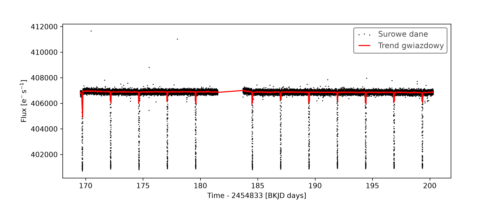
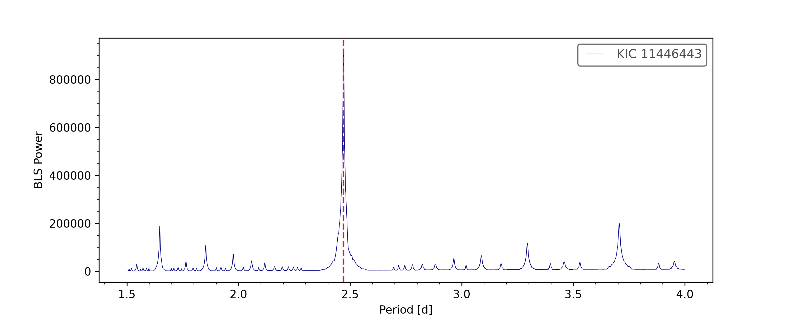
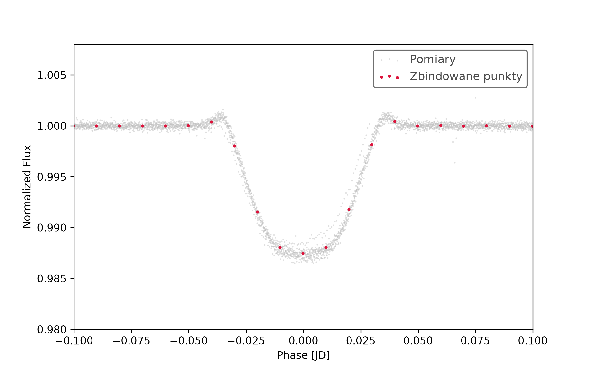

# Exoplanet Transit Photometry Pipeline

Automated Python data pipeline for exoplanet transit detection and planetary parameter derivation from Kepler space telescope photometry.

The pipeline pulls raw quarter observations directly from the NASA MAST archive, performs baseline detrending while preserving transit morphology, runs a Box Least Squares (BLS) periodogram search, and calculates the physical properties of the detected exoplanet.

## Pipeline Architecture

The source code is structured as a modular package in `src/`:

- `fetch_data.py`: Handles queries and downloads from the Kepler mission archives via `lightkurve`.
- `preprocess.py`: Cleans missing cadence data and fits stellar variability trends using Savitzky-Golay filtering.
- `bls_search.py`: Evaluates grid-based BLS power spectra to recover orbital periods ($P$) and transit epochs ($T_0$).
- `transit_model.py`: Phase-folds light curves, bins photometric scatter, and applies analytical equations to estimate planet radius ($R_p$) and semi-major axis ($a$).
- `main.py`: Pipeline execution entry point saving processed artifacts to `outputs/`.

## Validated Case Study: TrES-2b (Kepler-1b)

The pipeline was validated against Quarter 2 observations of TrES-2 (KIC 11446443), successfully recovering the hot Jupiter TrES-2b.

| Parameter | Derived Value | NASA Archive Reference |
| :--- | :--- | :--- |
| Orbital Period ($P$) | 2.47060 d | 2.47063 d |
| Transit Depth ($\delta$) | 1.256% | ~1.300% |
| Planet Radius ($R_p$) | 1.091 $R_J$ / 12.226 $R_\oplus$ | 1.197 $R_J$ |
| Semi-Major Axis ($a$) | 0.0355 AU | 0.0356 AU |

### Physical Parameters Derivation

Transit depth is measured from binned phase-folded flux at mid-transit:

$$\delta \approx \left(\frac{R_p}{R_\ast}\right)^2 \implies R_p = R_\ast \sqrt{\delta}$$

Semi-major axis is computed via Kepler's Third Law using stellar mass ($M_* \approx 0.98 M_\odot$):

$$a = \left( \frac{G M_* P^2}{4 \pi^2} \right)^{1/3}$$

## Analysis Figures

### 1. Raw Photometry & Stellar Detrending
Raw Kepler flux showing regular transit dips and the fitted stellar baseline trend.


### 2. BLS Periodogram Search
Prominent BLS spectral power peak identifying the 2.4706-day orbital period.


### 3. Phase-Folded Transit Profile
Combined and binned transit light curve exhibiting classic limb-darkening profile.


## Installation & Execution

```bash
git clone https://github.com/your-username/Exoplanet_Transit_Photometry.git
cd Exoplanet_Transit_Photometry
pip install -r requirements.txt
python main.py
